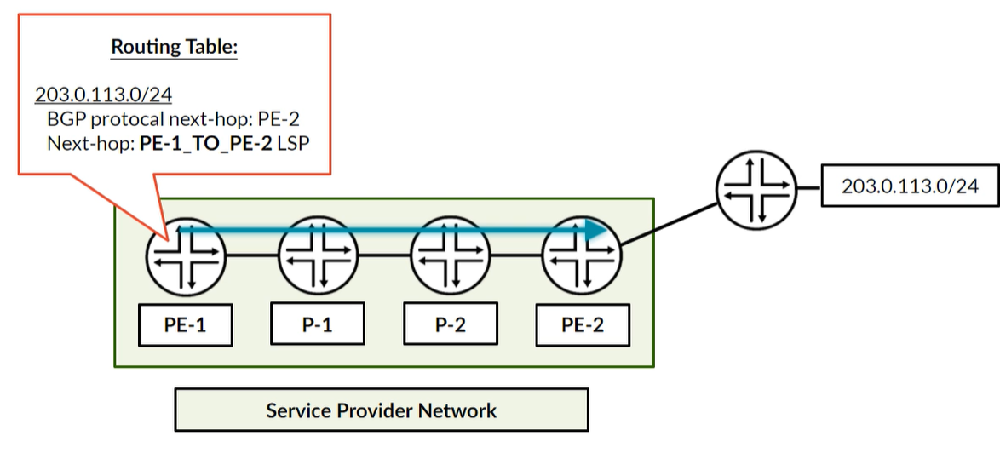
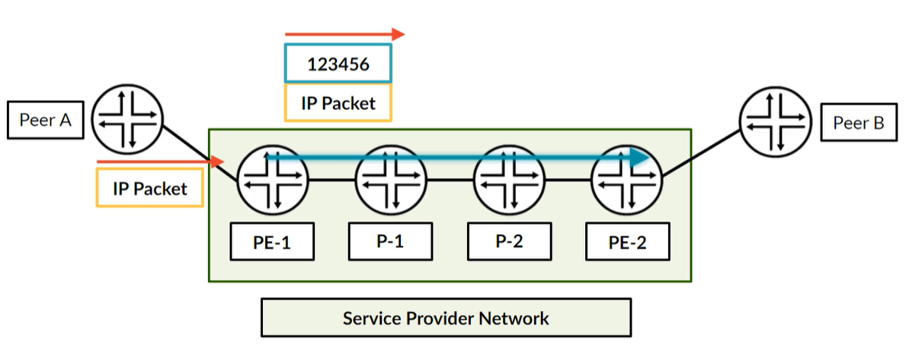
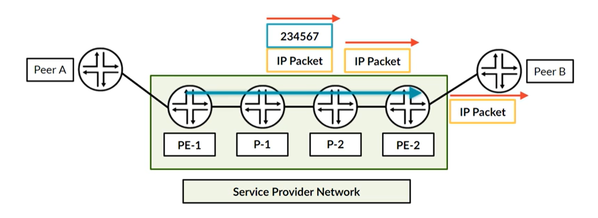
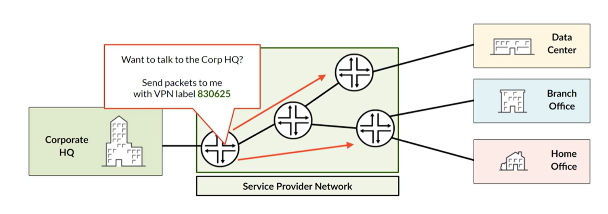
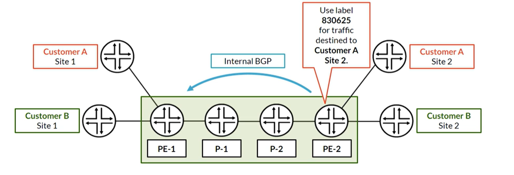
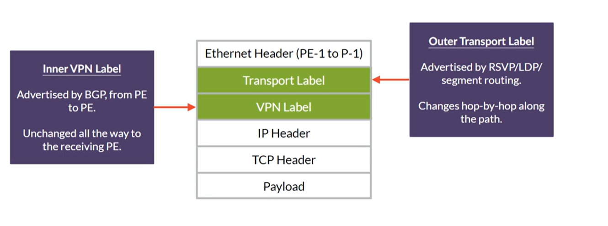
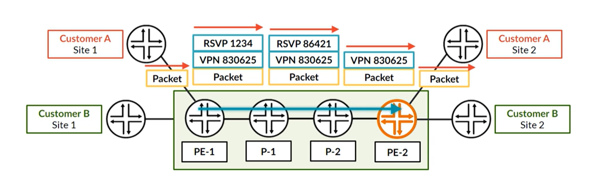
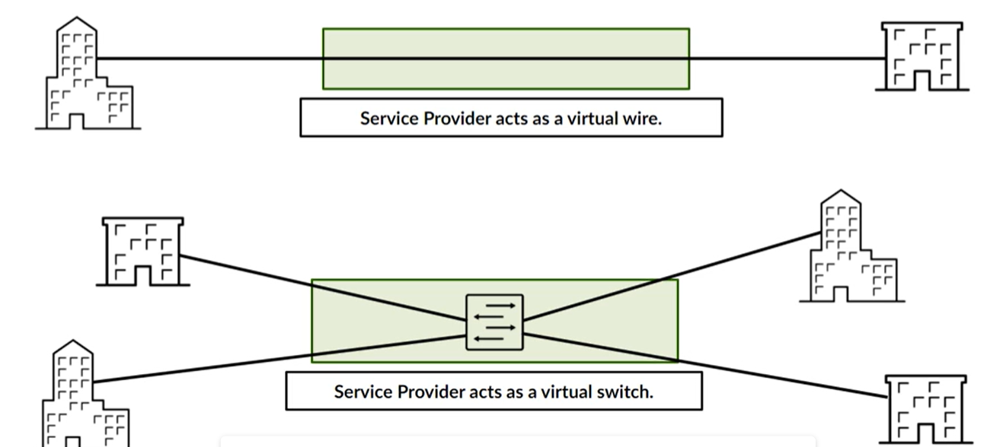
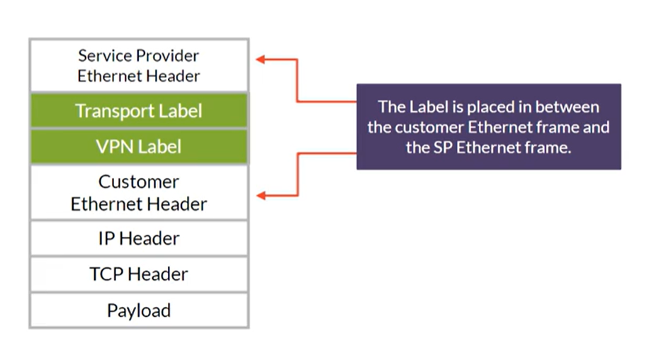

# Вспоминаем MPLS

## Базовый MPLS

**LSP** - туннель, который строится в сети провайдера. Маршрутизаторы коммутируют пакет на основе внешней метки в пакете.

**P-роутеры** не заглядывают в пакет, а просто меняют и\или удаляет метку в пакете. Им не обязательно владеть информацией о конеченых маршрутах, куда направляется трафик. Им нужно знать маршрут до таких же P/PE-роутеров.

**PE-роутер** - являются точкой входа трафика. Точнее, точкой входа в LSP. Когда пакет приходит, PE-роутер определяет, что с ним делать, какие метки навешать. Ему необходима информация о маршрутах (destination), куда он собрался отправлять трафик.

**CE-роутер** - клиентское устройство, трафик от которого попадает в LSP.

LSP можно гибко управлять. Можно направлять по разным роутерам, не заходя на другие.

LSP строится на Loopback, т.к. они, как правило, уже находятся в таблице маршрутизации каждого роутера. Если строить на других IP, их может не быть.

Роутер, по-умолчанию, маршруты полученные по BGP старается резолвить через LSP. То есть, если у нас iBGP на Loopback, то Protocol Next Hop для префикса будет этот Loopback удаленного роутера (от которого мы получили маршрут). А т.к. и LSP на Loopback, то Next Hop будет этот LSP.

Когда PE1 надо передать пакет в сеть на удаленном конце (к примеру 203.0.113.0), он смотрит в таблицу маршрутизации и видит, что надо отправить в LSP.

Чтобы его поместить в LSP, надо сделать **push** (повесить) метку на исходный IP пакет. В данном случае метка с номер 123456 возникла с помощью какого-то протокола MPLS. Эту метку сообщил P1 в сторону PE1. То есть P1 сказал: "Если ты хочешь чтобы я отправил пакет в сторону PE2, то пришли мне его с меткой 123456"

P1 при передачи пакета будет совершать **swap** метки. То есть, при передачи пакета просто заменит метку на другую (есть вероятнсоть, что метка останется той же, зависит от способа распростарнения меток).

При этом P2 при передачи на PE2 сделает **pop** метки. То есть, просто удалит метку и MPLS заголовок. Это называется **Penultimate Hop Popping**. Зачем он удалит, а не свапнет? Т.к. PE2 она по сути и не нужна. Он уже подключен к Peer B, к тому, куда надо отправить трафик. Если мы сохраним метку, PE2 придется сначала снять MPLS заголовок, потом сделать lookup в табицу маршрутизации, и потом отослать трафик. С PHP мы убираем шаг "снять MPLS заголовок" на PE2.

Для такого действия зарезервирована метка 3. То есть PE2 отправил P2 сообщение, что если надо мне прислать трафик, надо прислать с меткой 3. А метка 3 в свою очередь специальная, которая говорит, что нужно удалить вообще метку.

Существует 4 протокола для создания LSP:

* LDP - автоматически распространяем метки, опираяюсь на протокол внутренней маршрутизации (IGP) для использования лучшего пути. Как правило, требует просто включения на интерфейсе и в глобальной конфигурации. Так же существуют всякие дополнительные обвязки по типу LDP-IGP sync, и т.д.
* RSVP - ручное создание LSP. LSP - сущность однонаправленная, посему нужно настраивать как на Ingress, так и на Egress. То есть из картинок выше на PE1 в сторону PE2, и на PE2 в сторону PE1. При создании пробегают разные сообщение по типу Resv, Path и т.д. Изначально так же опирается на IGP, но с помощью Traffic Engeneering можно очень гибко управлять трафиком (пускать по определнным путям, в зависимости от полосы пропускания и т.д.)
* Segment Routing - распространяет метки внутри OSPF или IS-IS. То есть никакой дополнительный протокол не запускается.
* BGP Labeled Unicast - использует BGP, как правило в редких ситуациях. В основном между AS

## MPLS VPN

С помощью MPLS можно туннелировать различные виды трафика (IPv4, IPv6, Ethernet и другие виды протоколов). Это позволяет оргинзовывать Virtual Private Network для клиента (связывать различные точки). А так же отделать трафик клиентов друг от друга.

Достигается это путем VPN lable/Service lable (VPN метки/сервисные метки).

### L3VPN

В случае L3VPN, провайдерский PE обменивается маршрутами с клиентским CE (BGP, OSPF, Static). В этом случае провайдер изучает клиентские сети.

У клиентов сети могут пересекаться, и чтобы они не мешали в GRT для каждого клиента создается своё пространство - VRF (Vitrual Routing and Forwarding). Очень похож на Virtual Router

Так же, используется дополнительные настройки в рамках BGP. PE-роутеры обмениваются специальным address family (VPNv4). Это специальные NLRI, у которых не только сам префикс (маршрут), но и дополнительная информация к нему (RD, Label и т.д.)

С точки зрения Data Plane L3VPN добавляет дополнительную метку в стек меток, которая называется Сервисной меткой (клиентской). P-роутеры её не видят, да и им незачем. Она необходима для PE-роутера, чтобы определить клиента.

> Стоит отметить, что VPN метка накидывается на пакет, который пришел от клиента. То есть IP заголовок, это IP клиента, не PE!

Когда пакет приходит от клиента, резолвинг маршрута происходит в его конкретном VRF.

По картинке ниже пояснения. PE1 вешает клиентскую метку 830625 и транспортную метку 1234. Обе метки были получены из разных протоколов. Далее P1 просто свапает транспортную метку. Далее P2, т.к. он предпоследний роутер, снимает транспортную метку (механизм PHP), и отправляет в сторону PE2 уже пакет только с сервисной меткой.

Лично у меня появился вопрос. Как PE2 отличает, что это именно клиентская метка. Основной замысел в том, что ВСЕ метки лежат в таблице mpls.0 (LFIB - Cisco, ILM - Huawei). То есть не только на Swap, Pop транспортных меток, но и Pop клиентских меток.
Для роутера вообще нет разницы как мы назвали метку: транспортная или клиентская. Для него всё одно. А раз всё одно, то и находятся они все в mpls.0. 

### L2VPN

В случае L2VPN провайдер выступает как прямой провод, или как коммутатор, который соединяет клиентские точки на уровне L2. То есть клиентские устройства находятся в одной сети. В случае "коммутатора" происходит процесс изучения MAC адресов. 

В L2VPN стек меток находится между L2 заголовком провайдера и L2 заголовком клиента

