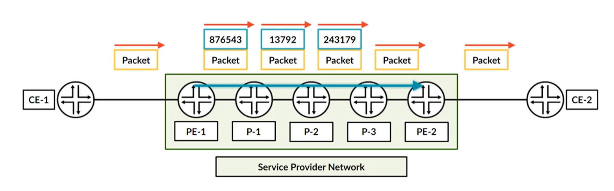
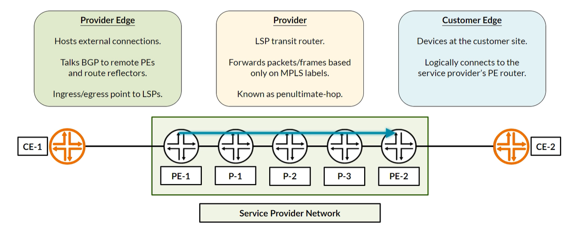
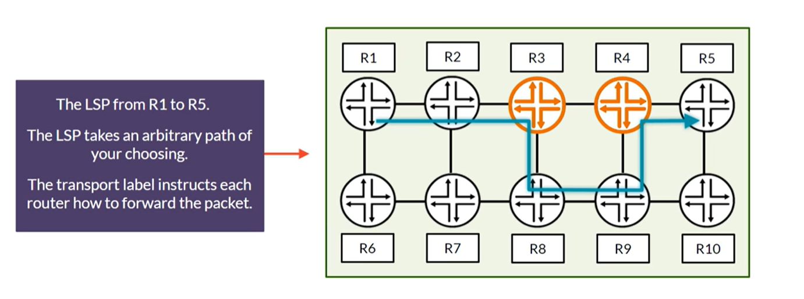

# Вспоминаем MPLS

LSP - туннель, который строится в сети провайдера. Маршрутизаторы коммутируют пакет на основе внешней метки в пакете.

P-роутеры не заглядывают в пакет, а просто меняют и\или удаляет метку в пакете. Им не обязательно владеть информацией о конеченых маршрутах, куда направляется трафик. Им нужно знать маршрут до таких же P/PE-роутеров.

PE-роутер - являются точкой входа трафика. Точнее, точкой входа в LSP. Когда пакет приходит, PE-роутер определяет, что с ним делать, какие метки навешать. Ему необходима информация о маршрутах (destination), куда он собрался отправлять трафик.

CE-роутер - клиентское устройство, трафик от которого попадает в LSP.

LSP можно гибко управлять. Можно направлять по разным роутерам, не заходя на другие.

