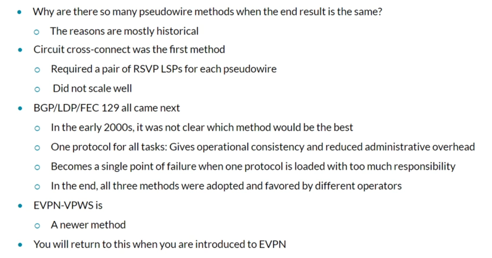

Существуют два разных вида MPLS VPN, работающих на L2: virtual wires и virtual switch

Vrtual wires - Соединение точка-точка. Провайдер прозрачно передает кадры, MAC адреса при этом не изучаются.

Virtual switch - соединение точка-многоточка. Для клиента является коммутатором по сути, у провайдера это может быть множество устройств. Происходит изучение MAC адресов

# Pseudowires

Соединение точка-точка. Для клиента выглядит как провод/удлинитель/etc, только виртуальный. Устройства провайдера не видны для клиента, он не знает сколько там их всего установлено и кто еще замешан.

Полностью инкапсулируют все данные, что зашли в псевдопровод. Даже те, что работают link-local (LLDP, OSP) и т.д. Псевдопровод так же еще называют virtual private wire service (VPWS)

Для настройки можно использовать весь физический интерфейс. При этом ВЕСЬ трафик, который попадет в порт, улетит по PW на второй конец. Тэги VLAN при этом считаются полезной нагрузкой, и не снимаются.

Не обязательно под VPWS отдавать весь физический порт целиком (да и не целесообразно это иногда). Вместо этого можно создать sub-interface для каждого клиента, и каким-то образом его пометить (VLAN к примеру). Трафик разных PW не смешивается между собой.

## Создание Pseudowires

Существует 5 способов создания Pseudowires. В целом, на картинке они описаны:

Почему их столько много, аж целых 5?

Так исторически сложилось, вот коротечно:

Два наиболее распоространенных метода для сигнализации Pseudowires: BGP и LDP (точнее tLDP).

BGP (в Junos L2VPN) - более длиная конфигурация на PE, но есть автообнаружение PE. Требует включение AFI в BGP - L2VPN. На PE создается routing-instance L2VPN, туда помещается unit клиента. Еще называют Kompella Circuit - в честь Кирити Компела, сотрудник  Juniper, придумавший это стандарт (draft-kompella-l2vpn)

LDP (в Junos L2Circuit) - более простая конфигурация, но необходимо руками настраивать ответную PE (то есть на обоих концах). Еще называют Martini Circuit - в честь Луки Мартиги, сотрудник Cisco, придумавший этот стандарт ()draft-martini-l2circuit)

Так же существует старый метод создания точка-точка: Circuit Cross-Connect. Метод подразумевает создание и использование одного LSP конкретно под этот L2 канал. 

Недостатки - это масштабируемость, т.к. для одного канала нужно создать 2 LSP, для 40 каналов уже 80 LSP.

Достоинства тоже есть (но смонительные) - используется всего одна метка. Обычно этот плюс возникает, когда есть оборудование или ситуация, где может пройти только одна метка MPLS. 

# VPLS

# EVPN
