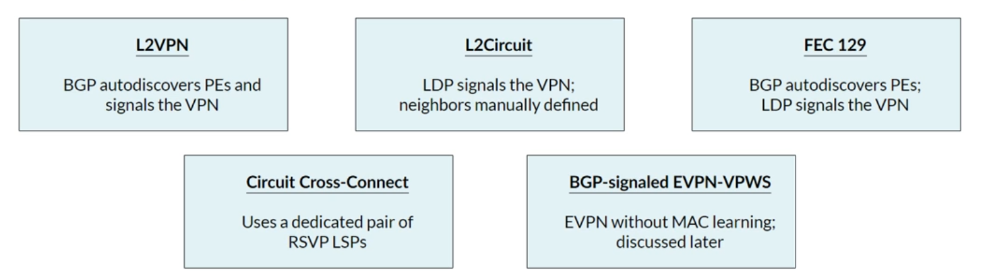
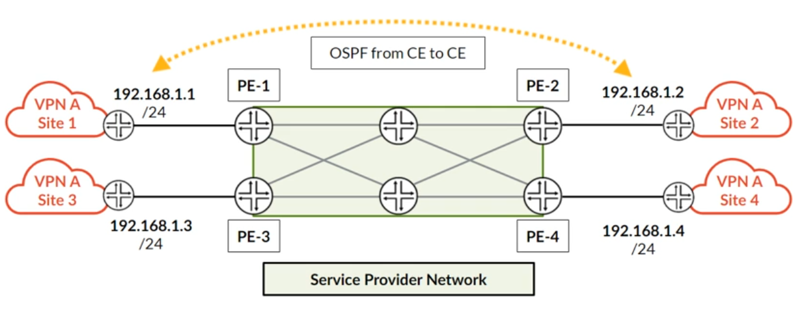
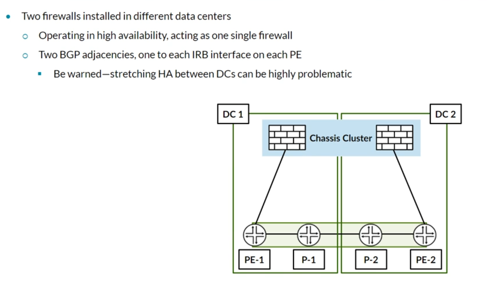
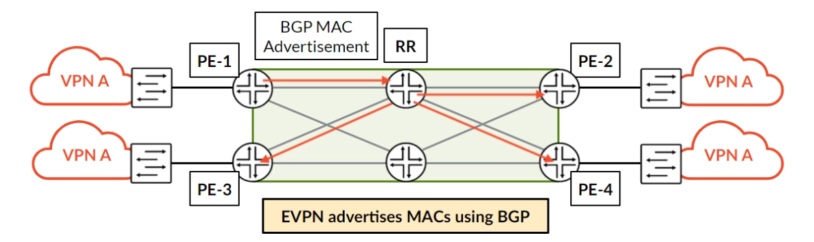
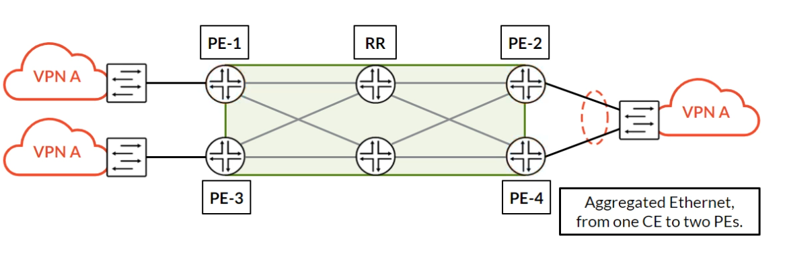

Существуют два разных вида MPLS VPN, работающих на L2: virtual wires и virtual switch

Vrtual wires - Соединение точка-точка. Провайдер прозрачно передает кадры, MAC адреса при этом не изучаются.

Virtual switch - соединение точка-многоточка. Для клиента является коммутатором по сути, у провайдера это может быть множество устройств. Происходит изучение MAC адресов

# Pseudowires

Соединение точка-точка. Для клиента выглядит как провод/удлинитель/etc, только виртуальный. Устройства провайдера не видны для клиента, он не знает сколько там их всего установлено и кто еще замешан.

Полностью инкапсулируют все данные, что зашли в псевдопровод. Даже те, что работают link-local (LLDP, OSP) и т.д. Псевдопровод так же еще называют virtual private wire service (VPWS)

Для настройки можно использовать весь физический интерфейс. При этом ВЕСЬ трафик, который попадет в порт, улетит по PW на второй конец. Тэги VLAN при этом считаются полезной нагрузкой, и не снимаются.

Не обязательно под VPWS отдавать весь физический порт целиком (да и не целесообразно это иногда). Вместо этого можно создать sub-interface для каждого клиента, и каким-то образом его пометить (VLAN к примеру). Трафик разных PW не смешивается между собой.

## Создание Pseudowires

Существует 5 способов создания Pseudowires. В целом, на картинке они описаны:

Почему их столько много, аж целых 5?

Так исторически сложилось, вот коротечно:

Два наиболее распоространенных метода для сигнализации Pseudowires: BGP и LDP (точнее tLDP).

BGP (в Junos L2VPN) - более длиная конфигурация на PE, но есть автообнаружение PE. Требует включение AFI в BGP - L2VPN. На PE создается routing-instance L2VPN, туда помещается unit клиента. Еще называют Kompella Circuit - в честь Кирити Компела, сотрудник  Juniper, придумавший это стандарт (draft-kompella-l2vpn)

LDP (в Junos L2Circuit) - более простая конфигурация, но необходимо руками настраивать ответную PE (то есть на обоих концах). Еще называют Martini Circuit - в честь Луки Мартиги, сотрудник Cisco, придумавший этот стандарт ()draft-martini-l2circuit)

Так же существует старый метод создания точка-точка: Circuit Cross-Connect. Метод подразумевает создание и использование одного LSP конкретно под этот L2 канал.

Недостатки - это масштабируемость, т.к. для одного канала нужно создать 2 LSP, для 40 каналов уже 80 LSP.

Достоинства тоже есть (но смонительные) - используется всего одна метка. Обычно этот плюс возникает, когда есть оборудование или ситуация, где может пройти только одна метка MPLS.

# VPLS

Для клиента выглядит как большой распределенный виртуальный коммутатор. Но по сути является серией Pseudowires.

PE в VPLS изучает MAC адреса, как это делает обычный коммутатор. Так же происходит процесс фладинга во все порты, если MAC неизвестен. В нём можно запустить STP (или может быть своя логика предотвращения петель). В нём так же можно создать IRB интерфейс (аналог SVI для VLAN).  Изучение MAC происходит на data plane, что в некотором роде является недостатком и в определенных ситуациях может породить проблемы.

Для VPLS можно использовать для сигнализации BGP, LDP, FEC 129.

Клиент может спокойно поверх VPLS запускать свои протоколы, которые ему нужны, к примеру OSPF. Для него подключения CE будут прозрачными. 

VPLS можно настроить так, чтобы устройства внутри VPLS могли общаться между собой. А можно настроить как hub-and-spoke, то есть удаленные площадки общаются только с одной центральной точкой.

Можно еще Firewall в разных точках соединить в кластер, но кажется это решение не очень удачным

# EVPN

Основные проблемы VPLS:

- изучение MAC адреса на Data Plane
- невозможность сделать два активных подключение к двух разных PE от одного CE. Придется или запускать STP, или хитро настраивать VPLS, в котором будет только один активный линк
- при использовании клиентом VRRP (к примеру), может быть неоптимальная маршрутизация, т.к. актвный шлюз юудет на PE1 (к примеру), а трафик направлен в сеть, которая живет на PE2 (резервный шлюз). Таким образом трафик будет идти дольше, хотя мог сразу попасть на нужный PE

EVPТ (Ethernet VPN) - предназначен для решения проблем VPLS. Он точно так же прозрачен для клиента и представляет собой виртуальный коммутатор. Но основное отличие в том, что полностью ВЕСЬ сигналинг переходит на Control Plane (BGP):

- изучение MAC адресов (позволяет быстро и массово распространять и отзывать адреса)

- использовать Active\Active линки между двумя PE и одним CE. Что в свою очередь увеличивает capacity по полосе, балансировку, и резервирование

- все PE могут иметь активный IRB, что устраняет надобность в VRRP

Под что используется VPLS, так же используется и EVPN. Очень и очень в ЦОДах используется.
